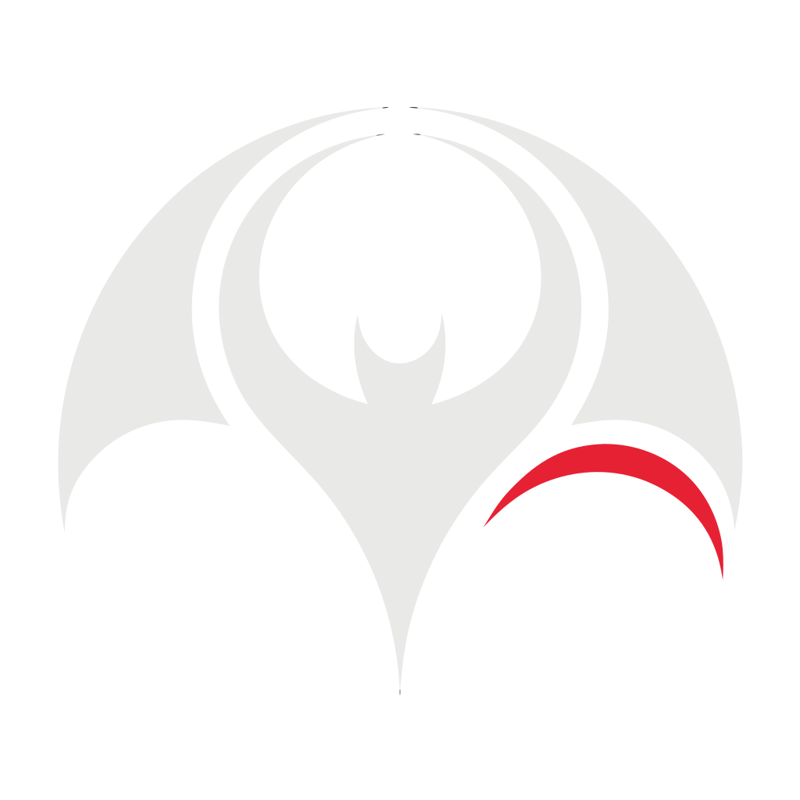
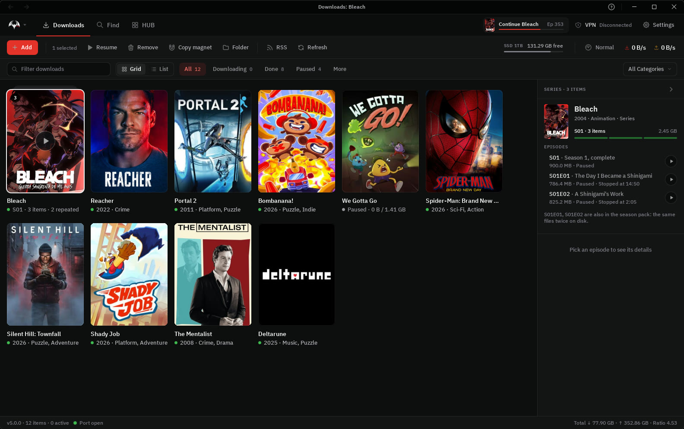
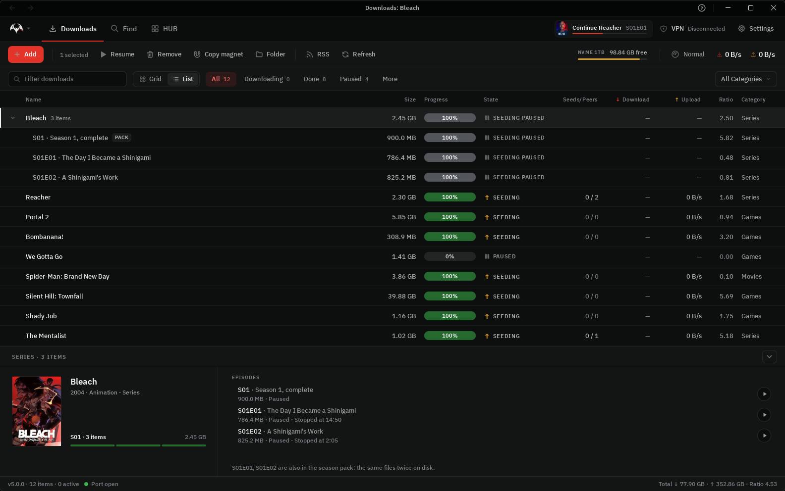
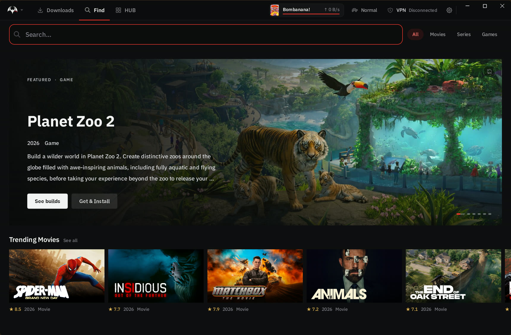
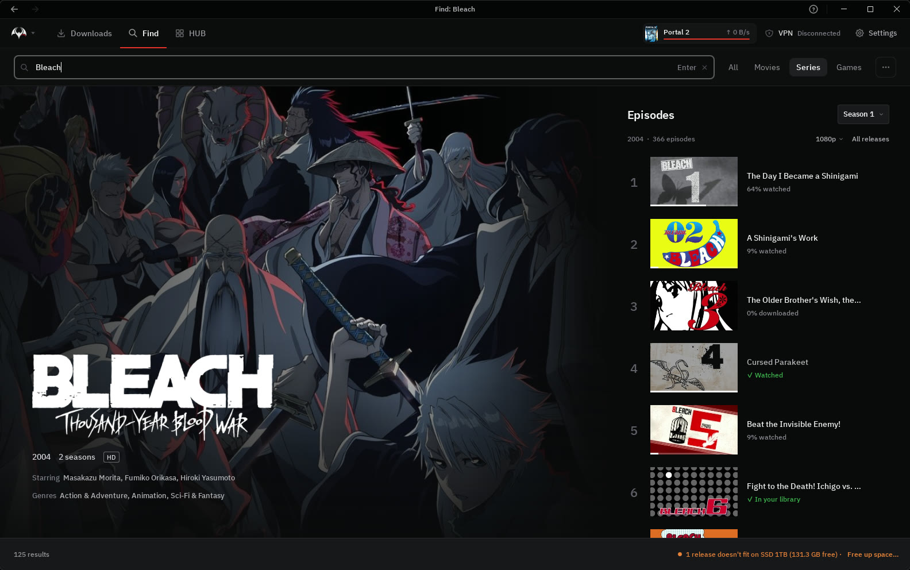
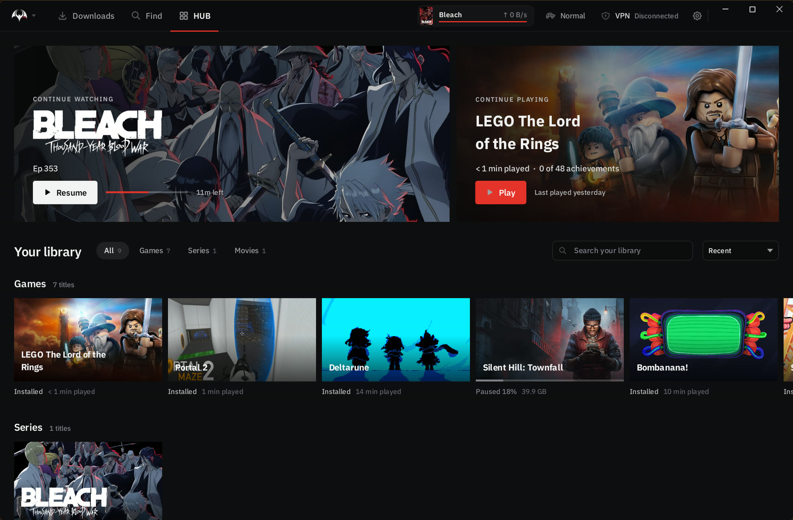
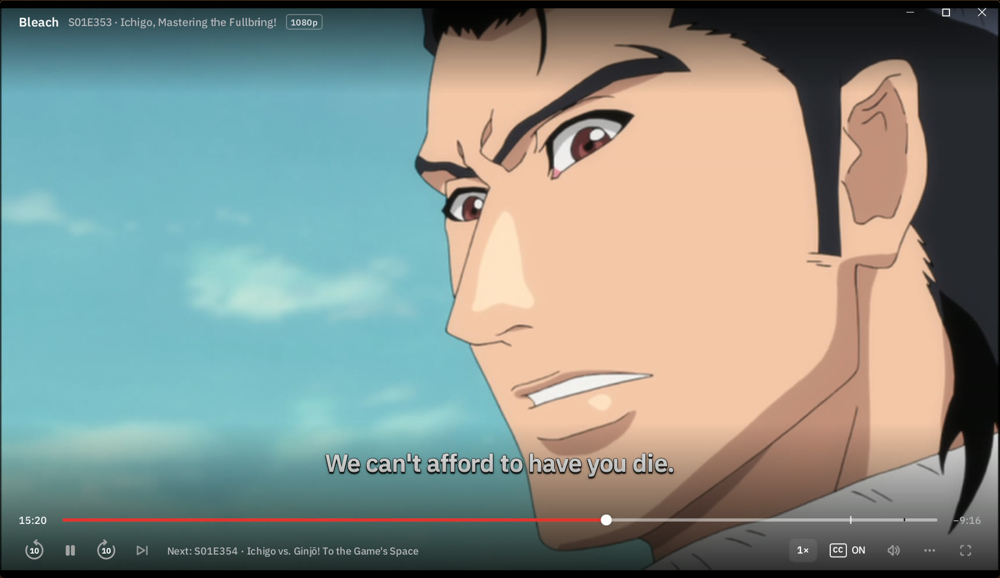
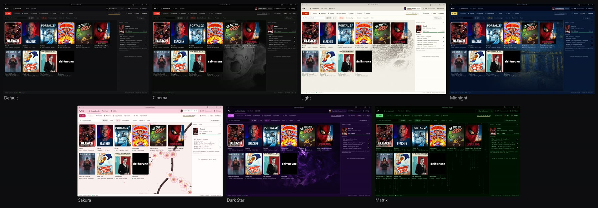

<p align="center">
  <a href="README.md">English</a> | <a href="README.pt-BR.md">Português</a> | <a href="README.zh-CN.md">中文</a> | <a href="README.ja.md">日本語</a> | <b>Русский</b> | <a href="README.es.md">Español</a> | <a href="README.de.md">Deutsch</a> | <a href="README.ua.md">Українська</a>
</p>

<p align="center">
  
</p>

<h1 align="center">BATorrent</h1>

<p align="center">
  Торрент-клиент, который показывает загрузки обложками, воспроизводит их прямо во время скачивания<br>
  и держит ваши фильмы, сериалы и игры в одной библиотеке.
</p>

<p align="center">
  <a href="https://github.com/BATorrent-app/BATorrent/releases/latest"></a>
  <a href="https://github.com/BATorrent-app/BATorrent/releases"></a>
  <a href="LICENSE"></a>
  
  <a href="https://apps.microsoft.com/detail/9n4l3tq24rc6"></a>
</p>

<p align="center">
  <a href="#установка"><b>Скачать</b></a> &nbsp;·&nbsp;
  <a href="https://batorrent.com/assets/trailer.mp4"><b>Смотреть трейлер</b></a> &nbsp;·&nbsp;
  <a href="https://batorrent.com"><b>Сайт</b></a>
</p>

<p align="center">
  
</p>

BATorrent это десктопный торрент-клиент на [libtorrent](https://www.libtorrent.org/), том же движке, что используют qBittorrent и Deluge. Он читает имя каждого торрента, находит подходящий постер (TMDB для фильмов и сериалов, IGDB для игр) и показывает загрузки обложками вместо имён файлов. Эпизоды одного сериала собираются вместе, видео можно смотреть в приложении ещё до конца загрузки, а игры устанавливаются и запускаются из того же окна.

Он бесплатный и с открытым исходным кодом. Без рекламы, без аккаунта, без «Pro»-версии, без аналитики. Помимо самих торрентов, он выходит в сеть за тремя вещами: обложки и описания из TMDB, IGDB и Steam для того, что есть в вашей библиотеке или что вы открываете в «Найти»; проверка обновлений на GitHub, которую можно отключить ([`updater.cpp`](src/services/integrations/updater.cpp)); и, в официальных сборках, отчёт о сбое, если приложение упало (его тоже можно отключить).

## Три вкладки

Наверху у приложения три вкладки: **Загрузки**, **Найти** и **HUB**.

### Загрузки

Ваши торренты сеткой обложек или плотным списком, а сбоку подробности того, что выбрано. Сериал сворачивается в одну строку с эпизодами внутри, так что двенадцать эпизодов занимают одну строку, а не двенадцать.

<p align="center">
  
</p>

### Найти и HUB

**Найти** это место, где ищут что-то новое: главная страница с популярными фильмами, сериалами и играми и поиск по всем вашим источникам, который ставит лучшее совпадение первым. У каждого тайтла своя страница. На странице фильма перечислены его релизы, отсортированные по тому, сколько людей их раздаёт, с рекомендованным вариантом, а ниже остальные фильмы его коллекции. На странице сериала эпизоды разбиты по сезонам и видно, что у вас уже есть и что вы посмотрели.

<table>
  <tr>
    <td width="50%"></td>
    <td width="50%"></td>
  </tr>
  <tr>
    <td align="center"><sub>Фильм в «Найти»</sub></td>
    <td align="center"><sub>Сериал в «Найти»</sub></td>
  </tr>
</table>

**HUB** это библиотека того, что у вас уже есть: «Продолжить просмотр», «Продолжить игру» и всё остальное, разложенное по играм, сериалам и фильмам.

<p align="center">
  
</p>

## Плеер

Встроенный плеер работает на FFmpeg, поэтому MKV, AVI и WebM воспроизводятся напрямую. Начало файла скачивается первым, так что смотреть можно, пока докачивается остальное. Плеер запоминает, где вы остановились, пропускает заставки, а в конце предлагает следующий эпизод или следующий фильм коллекции. Он сам находит субтитры (через SubDL) или подхватывает `.srt`, лежащий рядом с файлом. Декодирование идёт в отдельном изолированном процессе, поэтому битый файл не уронит вместе с собой всё приложение.

<p align="center">
  
</p>

Если у вас есть аккаунт [Real-Debrid](https://real-debrid.com) или [TorBox](https://torbox.app) и торрент уже лежит у них в кэше, видео идёт потоком оттуда, и на ваш компьютер ничего не скачивается и ничего не раздаётся.

## Что ещё он умеет

- **Игры.** Обложки из IGDB, установка и запуск из HUB, игровое время и достижения. Скачанные игры выглядят как лаунчер, а не как папка с установщиками.
- **VPN.** Импортируйте WireGuard `.conf` (Proton, Mullvad, IVPN...) и подключайтесь. Через него идёт только BATorrent, остальной компьютер остаётся на обычном подключении, и в систему ничего не устанавливается. Если соединение падает, он переподключается сам, kill switch останавливает торренты, пока связь не вернётся, а на серверах, которые это поддерживают, открывает порт, чтобы до вас могли достучаться пиры.
- **Приватность.** Тест утечки, который показывает IP, видимый вашим пирам, привязка к сетевому интерфейсу, режим приватных трекеров, пресет Tor и блокировка известных клиентов-пиявок.
- **Добавление.** Вставьте magnet, ссылку или info-hash где угодно через Ctrl+V. RSS с regex-фильтрами, папка наблюдения, drag and drop и обычные загрузки по HTTP/HTTPS.
- **Удалённое управление.** WebUI, который открывается на телефоне по QR-коду. Код генерируется на вашем компьютере.
- **Упорядочивание.** Категории и теги, автораспаковка архивов, лимиты рейтинга и времени, расписание скорости по часам и дням и альтернативная скорость (черепаха) в один клик.
- **Внешний вид.** Семь тем, у каждой свой шрифт и арт, или ваша собственная; чистый фон, арт темы или ваша картинка. Палитра команд по Ctrl/⌘+K. Девять языков и короткая настройка при первом запуске.

<p align="center">
  
</p>

<details>
<summary><b>Полный список</b></summary>

Приоритет отдельных файлов, последовательная загрузка, добавление трекеров, управление раскладкой содержимого, regex для исключения файлов, отдельная временная папка, окна раздачи, автопауза при пропаже файлов, обновление библиотеки Plex/Jellyfin/Emby, уведомления в Telegram и Discord, импорт из qBittorrent, создание `.torrent`, IP-блоклисты, шифрование протокола, зеркало обновлений на Gitee, стабильный и бета-канал обновлений, выключение после завершения загрузок, помощник для исключения в Windows Defender, резервное копирование и восстановление, история недавно удалённых, принудительный запуск, просмотр логов с диагностикой, строка меню по Alt, фильмы одной коллекции сгруппированы в библиотеке и горячие клавиши почти для всего.

</details>

## Движок

BATorrent поставляется с небольшим пропатченным форком libtorrent, который собирается из версионированных патчей в [`third_party/patches/`](third_party/patches):

- **Более быстрый разгон.** На быстром канале с большой задержкой стандартный libtorrent наращивает конвейер запросов по одному шагу. Форк наращивает его геометрически и заполняет канал за гораздо меньшее число обменов. В A/B-прогонах проекта это дало примерно на 27% быстрее на быстром соединении и ни разу не было медленнее стандартной версии.
- **Пиры из своей страны.** Офлайн-база GeoIP (db-ip Lite) помечает каждый пир страной, и когда есть выбор, форк предпочитает пиров из вашей страны, что обычно означает меньшую задержку.

Обе возможности включаются при компиляции и выключены в стандартной сборке.

## Установка

| Платформа | Загрузка | Требования |
|---|---|---|
| **Windows** | [Microsoft Store](https://apps.microsoft.com/detail/9n4l3tq24rc6) · [Установщик](https://batorrent.com/win) · [Портативная версия](https://batorrent.com/portable) | Windows 10 или новее |
| **macOS** | `brew install --cask Mateuscruz19/batorrent/batorrent` или [`.dmg`](https://batorrent.com/mac) | macOS 12+, Apple Silicon |
| **Linux** | [AppImage](https://batorrent.com/linux) | glibc 2.35+ |

После запуска перетащите в окно `.torrent` или magnet-ссылку.

<sub><b>macOS:</b> приложение пока не нотаризовано (программа разработчика Apple это платная подписка). Проще всего ставить через Homebrew, потому что он снимает флаг карантина. Если вы берёте <code>.dmg</code>, в первый раз щёлкните по приложению правой кнопкой и выберите <b>Открыть</b>.</sub>

<details>
<summary><b>Сборка из исходников</b></summary>

**Требования:** C++17, CMake 3.16+, Qt 6 (`Widgets`, `Network`, `Svg`, `Multimedia`, `Quick`, `QuickWidgets`, `QuickControls2`), libtorrent-rasterbar 2.0+, Boost, zlib и, по желанию, Qt6Keychain.

```bash
# Debian / Ubuntu
sudo apt install build-essential cmake qt6-base-dev qt6-svg-dev qt6-multimedia-dev \
    libtorrent-rasterbar-dev libboost-dev libssl-dev
cmake -B build -DCMAKE_BUILD_TYPE=Release && cmake --build build -j && ./build/BATorrent
```

На macOS: `brew install qt libtorrent-rasterbar boost openssl`.
На Windows: установщик Qt и `vcpkg install libtorrent:x64-windows`.

</details>

<details>
<summary><b>Качество и безопасность</b></summary>

<p>
  <a href="https://github.com/BATorrent-app/BATorrent/actions/workflows/codeql.yml"></a>
  <a href="https://github.com/BATorrent-app/BATorrent/actions/workflows/sanitizers.yml"></a>
  <a href="https://sonarcloud.io/summary/new_code?id=Mateuscruz19_BAT-Torrent"></a>
  <a href="https://www.codefactor.io/repository/github/mateuscruz19/batorrent"></a>
  <a href="https://www.bestpractices.dev/projects/13073"></a>
</p>

- Набор тестов на Catch2 (модульные, безопасность, память) и тесты QML прогоняются в каждой CI-сборке.
- Сборка проходит под AddressSanitizer и UndefinedBehaviorSanitizer.
- Секреты хранятся в keychain ОС, а WebUI становится доступен из сети только после того, как вы зададите пароль.

</details>

## Зачем я его сделал

Я один разработчик из Бразилии. Мне был нужен торрент-клиент, который серьёзно относится к приватности, нативно работает на Windows, macOS и Linux и не выглядит так, будто его сделали в 2009 году. Такого, который бы мне понравился, я не нашёл, поэтому написал свой. Он под лицензией MIT, так что если в нём когда-нибудь появятся реклама или слежка, любой сможет форкнуть его и выпустить версию без них.

## Участие

Issues и pull requests приветствуются. Если изменение больше мелкого исправления, сначала откройте issue, чтобы договориться о подходе. В сообщении об ошибке полезнее всего указать платформу, версию (из `Справка → О BATorrent`) и шаги для воспроизведения. Переводам особенно рады. Если вы пользуетесь инструментами ИИ, сначала прочитайте, [как я использую ИИ](USING_AI.md).

## Лицензия и товарный знак

**Код** распространяется под лицензией [MIT](LICENSE), © 2024-2026 Mateus Cruz. Вы можете форкнуть его и выпускать собственную сборку.

**Название «BATorrent» и логотип** не подпадают под лицензию на код. Если вы выпускаете форк, дайте ему, пожалуйста, своё название, чтобы было понятно, какая сборка официальная. Подробности в [TRADEMARK.md](TRADEMARK.md).

<p align="center"><sub>Сделано в Бразилии.</sub></p>
